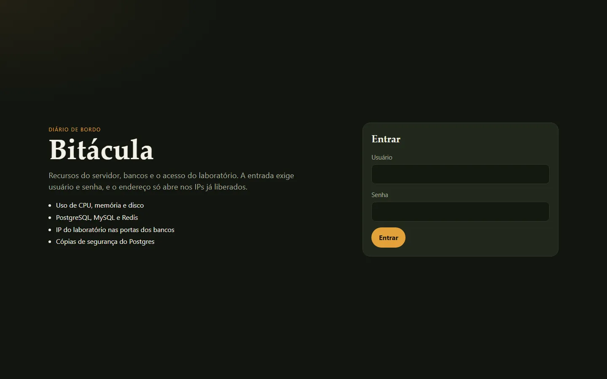
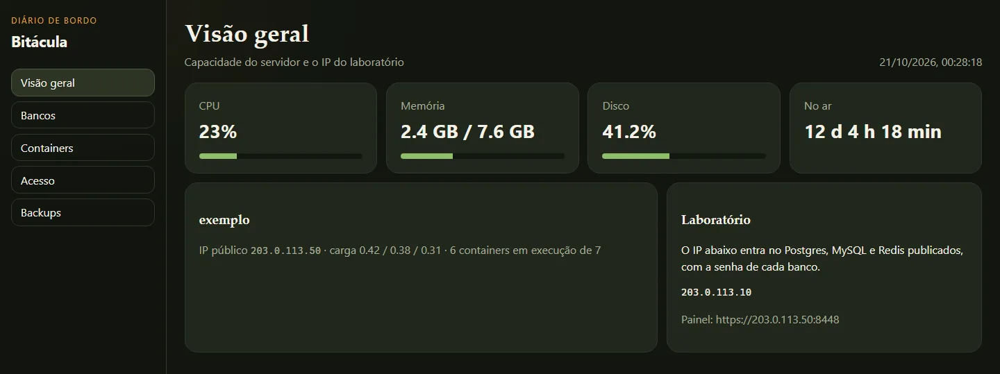
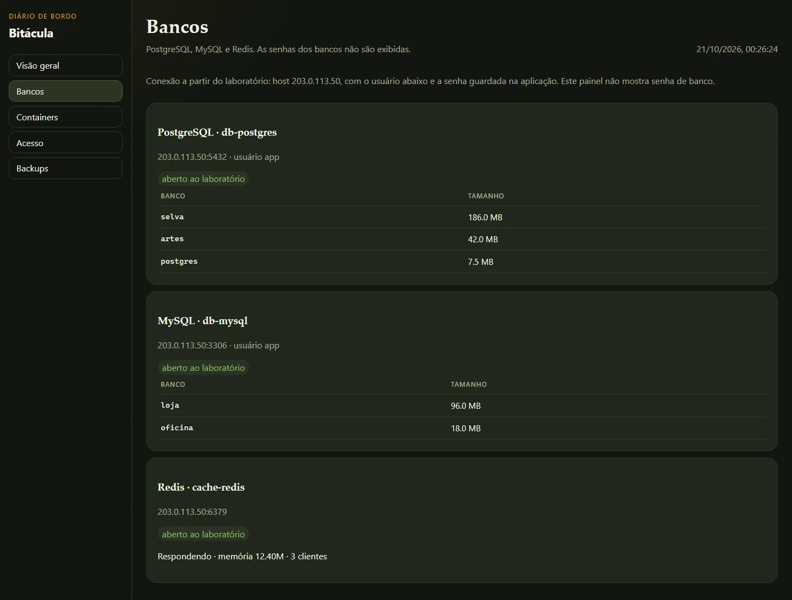
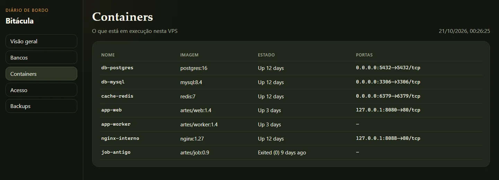
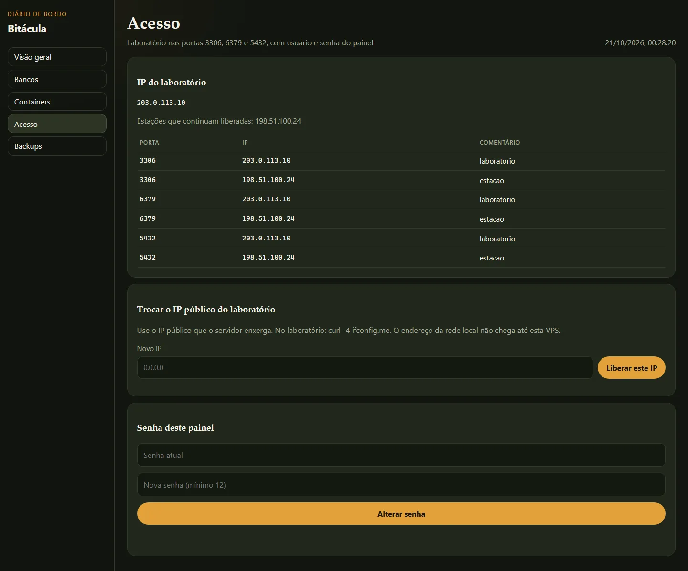
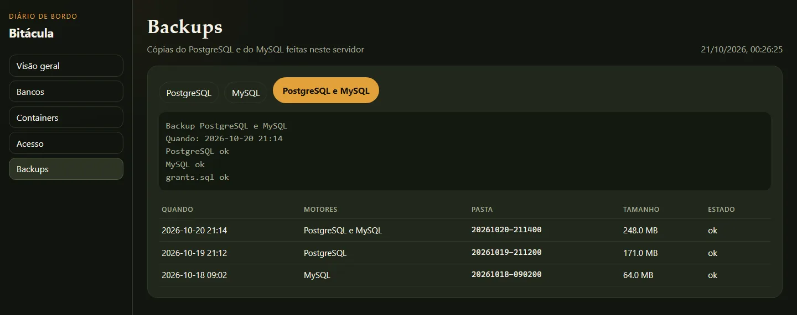

# Guia de uso

Versão 0.1.0. As telas desta página são uma amostra. Dá para ver o painel sem instalar e sem senha.

O usuário da captura é `quarto`. O nome da máquina é `exemplo`. Os bancos, os containers e os tamanhos também são de exemplo. Os endereços são da faixa de documentação da [RFC 5737](https://www.rfc-editor.org/rfc/rfc5737): `203.0.113.50` é a VPS, `203.0.113.10` é o laboratório, `198.51.100.24` é a estação que permanece.

## Entrar

O painel pede usuário e senha. Na máquina de verdade, a primeira subida grava `panel/CREDENCIAIS.txt`, só nela. Esse arquivo não entra no git. A senha de cada banco não aparece em lugar nenhum desta interface.



## Visão geral

Quatro cartões: CPU da máquina, memória em uso sobre o total, disco de `/` e há quanto tempo o servidor está no ar. Ao lado, o nome da máquina, o IP público e quantos containers estão em execução.

O cartão Laboratório mostra o IP que entra no Postgres, no MySQL e no Redis publicados. A senha de cada banco continua no container.



## Bancos

Cada instância diz o container, o host, a porta e o usuário. O selo verde indica que a porta está aberta ao laboratório. A tabela traz o nome e o tamanho. Redis mostra se respondeu, a memória e os clientes.



## Containers

A lista é a do Docker nesta VPS: nome, imagem, estado e portas. Container parado entra na tabela. Porta só interna aparece como `127.0.0.1`.



## Acesso

A tabela lista as portas 3306, 6379 e 5432. Na amostra, o laboratório e a estação fixa estão nas três. Trocar o IP substitui a linha do laboratório. A estação fixa continua.

O formulário pede o IP público, o mesmo que `curl -4 ifconfig.me` devolve no laboratório. O endereço da rede local não chega até a VPS.

A senha desta tela é a do painel, com no mínimo 12 caracteres. Ela não abre os bancos.



## Backups

Três ações: só PostgreSQL, só MySQL, ou os dois. Cada execução cria `backups/AAAAMMDD-HHMMSS/` na máquina. Postgres sai em `pg_dump -Fc`. MySQL sai comprimido, com `grants.sql`. A pasta não entra no git. O caminho para restaurar está no `MANIFEST.txt`. A senha da restauração é a do container.



## Instalar

```bash
git clone https://github.com/araguaci/bitacula.git
cd bitacula
sudo python3 panel/server.py
```

O processo escuta em `127.0.0.1:8787`. O nginx publica a porta `8448` e recusa origem fora da lista de estações. O navegador avisa do certificado local na primeira visita.

O painel não substitui o firewall. Ele escreve regra em cima do que você já confia. Não publique essa porta na internet aberta.
